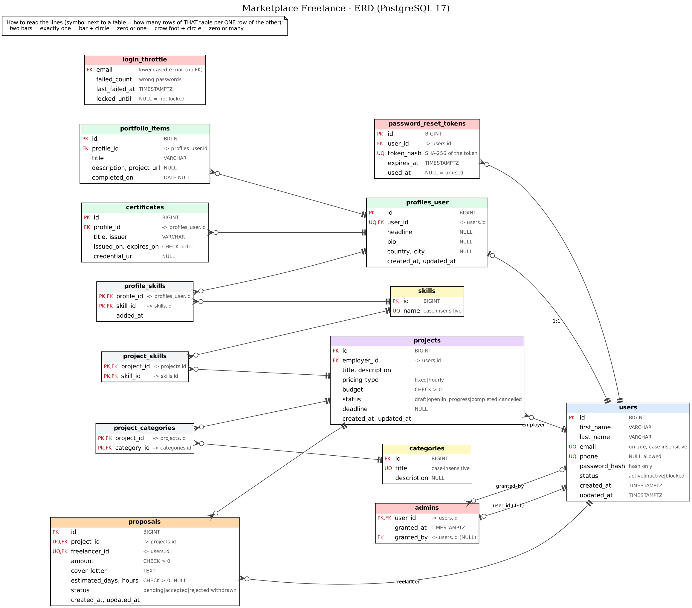

# Marketplace Freelance

پلتفرم فریلنسری (مشابه Upwork / پونیشا / کارلنسر): کارفرما پروژه ثبت می‌کند، فریلنسر پیشنهاد می‌دهد، کارفرما حداکثر یک پیشنهاد را می‌پذیرد.
این مخزن در **فاز اول** شامل تحلیل نیازمندی‌ها و **طراحی و پیاده‌سازی پایگاه داده** است.

| مورد | مقدار |
|---|---|
| DBMS | **PostgreSQL 17** (pgAdmin 4) |
| تیم | `[نام اعضا]` |
| Jira | `[لینک برد]` |
| نقش‌ها | کاربر عادی (هم کارفرما، هم فریلنسر) و مدیر (Admin) |

## ساختار مخزن

```
├── README.md
├── .gitignore
├── web/               # برنامهٔ وب: ورود، ثبت‌نام، بازیابی رمز (فاز ۳)
├── database/
│   ├── schema.sql     # ساخت جدول‌ها، قیدها، ایندکس‌ها، تریگرها
│   ├── seed.sql       # داده نمونه
│   ├── queries.sql    # Queryهای کاربردی
│   └── tests.sql      # تست خودکار قیدها و قواعد کسب‌وکار
└── docs/
    ├── erd.png        # نمودار ERD
    ├── requirements.md
    ├── jira-backlog.md
    └── setup-guide.md
```

## نحوهٔ ایجاد دیتابیس و اجرا

```bash
psql -U postgres -c "CREATE DATABASE lab_freelance ENCODING 'UTF8';"
psql -U postgres -d lab_freelance -v ON_ERROR_STOP=1 -f database/schema.sql
psql -U postgres -d lab_freelance -v ON_ERROR_STOP=1 -f database/seed.sql
psql -U postgres -d lab_freelance -f database/queries.sql
psql -U postgres -d lab_freelance -f database/tests.sql
```

`schema.sql` قابل اجرای مجدد است (ابتدا جدول‌های قبلی را DROP می‌کند — فقط برای محیط توسعه). جزئیات pgAdmin در `docs/setup-guide.md`.

## ERD



## جدول‌ها (۱۳ جدول)

| جدول | نقش |
|---|---|
| `users` | همهٔ حساب‌ها (عادی و مدیر) |
| `admins` | فهرست حساب‌های دارای دسترسی مدیریتی + زمان اعطا |
| `profiles_user` | پروفایل (حداکثر یکی برای هر کاربر) |
| `skills`, `categories` | جدول‌های مرجع (نام/عنوان یکتا) |
| `profile_skills` | واسط M:N پروفایل ↔ مهارت |
| `portfolio_items`, `certificates` | ۱:N از پروفایل |
| `projects` | پروژه‌ها (متعلق به یک کارفرما) |
| `project_categories`, `project_skills` | واسط M:N پروژه ↔ دسته / مهارت |
| `proposals` | پیشنهادها (پروژه + فریلنسر) |
| `password_reset_tokens` | لینک‌های بازیابی رمز (فقط اثر انگشت SHA-256 توکن ذخیره می‌شود؛ یک‌بارمصرف و زمان‌دار) |

## تصمیم‌های طراحی و دلیل‌ها

**۱. مدل‌سازی مدیر: جدول جدا `admins`، نه ستون `role`.**
صورت مسئله می‌خواهد «زمان اعطای دسترسی» ثبت شود و مدیر «فقط به قابلیت‌های مدیریتی» دسترسی داشته باشد. جدول جدا (۱:۱ با `users`) هم زمان اعطا (`granted_at`) و هم اعطاکننده (`granted_by`) را نگه می‌دارد، چند مدیر را پشتیبانی می‌کند و بدون ستون‌های NULL‌دار در `users` است. تشخیص مدیر با `is_admin(user_id)`.
هر دو قاعدهٔ «مدیر پروژه/پیشنهاد/پروفایل ندارد» با **تریگر** اجرا می‌شود (چون CHECK نمی‌تواند جدول دیگر را ببیند) و در جهت عکس هم برقرار است: کاربری که پروژه/پیشنهاد/پروفایل دارد مدیر نمی‌شود.

**۲. «کارفرما» و «فریلنسر» جدول جدا نیستند.**
هر کاربر عادی هر دو نقش را دارد؛ نقش از رابطه می‌آید: `projects.employer_id` و `proposals.freelancer_id` هر دو به `users` اشاره می‌کنند. بنابراین نام فریلنسر در `proposals` تکرار نمی‌شود (نرمال‌سازی).

**۳. جدول‌های واسط برای رابطه‌های چند‌به‌چند** با کلید اصلی ترکیبی (جلوگیری از تکرار): `profile_skills`, `project_categories`, `project_skills`. مهارت‌ها در `profiles_user` به‌صورت ستون متنی ذخیره نمی‌شوند (نقض نرمال‌سازی).

**۴. یکتایی بدون حساسیت به حروف.** ایمیل، نام مهارت و عنوان دسته با `UNIQUE INDEX ON lower(...)` یکتا هستند (`Python` و `python` یکی حساب می‌شوند). شمارهٔ موبایل اختیاری و در صورت وجود یکتاست (تصمیم ما؛ برای ورود با کد در آینده لازم می‌شود).

**۵. رمز عبور.** فقط `password_hash`؛ CHECK طول ≥ ۶۰ (bcrypt = ۶۰ کاراکتر) جلوی ذخیرهٔ ساده‌انگارانهٔ متن ساده را می‌گیرد. هش‌کردن واقعی وظیفهٔ برنامه است.

**۶. پروژه ساعتی/ثابت با یک ستون.** `projects.budget` و `proposals.amount` بسته به `pricing_type` یا مبلغ کل یا نرخ ساعتی‌اند (دو ستون جدا بیشتر NULL تولید می‌کرد). `estimated_hours` فقط برای پروژهٔ ساعتی مجاز است (تریگر). تغییر `pricing_type` بعد از دریافت پیشنهاد ممنوع است (وگرنه معنای مبلغ‌ها خراب می‌شود).

**۷. پیشنهاد پذیرفته‌شده ذخیره دوباره نمی‌شود.** ستونی مثل `projects.accepted_proposal_id` نداریم؛ از `proposals.status='accepted'` به‌دست می‌آید (جلوگیری از داده زائد و ناسازگاری). «حداکثر یک پذیرفته‌شده» با **ایندکس یکتای جزئی** `WHERE status='accepted'` تضمین می‌شود، علاوه بر تریگر.

**۸. حذف.** همهٔ کلیدهای خارجی به `users`، `projects`، `skills`، `categories` از نوع `ON DELETE RESTRICT` هستند؛ کاربران و پروژه‌ها حذف نمی‌شوند، بلکه `inactive/blocked` یا `cancelled` می‌شوند تا سوابق بماند. `CASCADE` فقط برای داده‌های وابستهٔ بی‌سابقه: جزئیات پروفایل (مهارت/نمونه‌کار/گواهینامه) و ردیف‌های واسط پروژه. `admins.granted_by` در حذف `SET NULL` می‌شود تا تاریخچه بماند.

**۹. وضعیت‌ها با `CHECK` روی متن** (نه `ENUM`)؛ افزودن وضعیت جدید بعداً فقط تغییر یک CHECK است.

**۱۰. واحد پول.** یک واحد (تومان). `NUMERIC(14,2)` به‌جای float برای پول.

**۱۱. زمان‌ها** `TIMESTAMPTZ`؛ `updated_at` با تریگر `set_updated_at` خودکار به‌روز می‌شود.

**۱۲. ایندکس‌ها** روی همهٔ کلیدهای خارجی پرکاربرد و `projects(status, created_at DESC)` برای فهرست پروژه‌های باز.

## چرخهٔ وضعیت‌ها

**پروژه** (تریگر `fn_projects_before_update`):

```
draft ──► open ──► in_progress ──► completed
  │         │            │
  └─────────┴────────────┴──► cancelled
```

- `open → in_progress` فقط وقتی یک پیشنهاد پذیرفته‌شده وجود دارد (در عمل خودکار با پذیرش پیشنهاد).
- `completed` و `cancelled` نهایی‌اند. پروژهٔ جدید فقط `draft` یا `open` شروع می‌شود.
- با لغو پروژه، پیشنهادهای `pending` آن خودکار `rejected` می‌شوند.

**پیشنهاد** (تریگر `fn_proposals_before_update`):

```
pending ──► accepted | rejected | withdrawn   (هر سه نهایی)
```

- ثبت پیشنهاد: فقط برای پروژهٔ `open`، فقط `pending`، نه برای پروژهٔ خود، نه توسط مدیر، فقط کاربر `active`.
- پذیرش: فقط وقتی پروژه `open` است؛ بعد از آن پروژه `in_progress` و سایر `pending`ها `rejected` می‌شوند (تصمیم ما، Q2 در `requirements.md`).
- فقط پیشنهاد `pending` قابل ویرایش (مبلغ/متن/زمان) است.
- `withdrawn` یعنی فریلنسر پیش از پذیرش پس گرفته؛ `rejected` یعنی کارفرما (یا لغو پروژه / پذیرش دیگری) رد کرده.

## سناریوهای آزمون

در `database/tests.sql` (۳۶ تست خودکار). هر تست در زیرتراکنش اجرا و برگردانده می‌شود، پس داده نمونه دست‌نخورده می‌ماند. SQLSTATE: `23505` یکتایی، `23503` کلید خارجی، `23514` CHECK/قاعده.

| # | سناریو | نتیجهٔ مورد انتظار | لایهٔ اعمال |
|---|---|---|---|
| 1–2 | ایمیل تکراری (حتی با حروف بزرگ) | 23505 | `UNIQUE INDEX lower(email)` |
| 3–4 | کلید خارجی نامعتبر | 23503 | FOREIGN KEY |
| 5 | پیشنهاد تکراری یک کاربر برای یک پروژه | 23505 | `UNIQUE(project_id, freelancer_id)` |
| 6–8 | بودجه / نرخ ساعتی صفر یا منفی | 23514 | `CHECK budget > 0` |
| 9–10 | مبلغ پیشنهاد صفر / زمان تخمینی صفر | 23514 | `CHECK` |
| 11 | پذیرش بیش از یک پیشنهاد در یک پروژه | 23514 | تریگر |
| 12 | همین، با تریگر غیرفعال | 23505 | ایندکس یکتای جزئی |
| 13 | پیشنهاد برای پروژهٔ خود | 23514 | تریگر |
| 14 | پیشنهاد برای پروژهٔ غیر Open | 23514 | تریگر |
| 15–18 | مدیر: پروژه/پیشنهاد/پروفایل / ارتقای کاربر دارای داده به مدیر | 23514 | تریگر |
| 19–21 | رمز متن ساده، ایمیل نامعتبر، وضعیت نامعتبر | 23514 | CHECK |
| 22–27 | انتقال وضعیت غیرمجاز، تغییر نوع قیمت، ویرایش پیشنهاد پذیرفته‌شده | 23514 | تریگر |
| 28–29 | حذف کاربر/پروژهٔ دارای سابقه | 23503 | `ON DELETE RESTRICT` |
| 30–32 | پروفایل دوم، مهارت/دستهٔ تکراری | 23505 | UNIQUE |
| 33–36 | موارد مثبت: پیشنهاد معتبر، پذیرش، پس‌گرفتن، لغو پروژه | 00000 | — |

## محدودیت‌ها و کارهای بعد

- وجود حداقل یک دسته/مهارت برای پروژهٔ Open در لایهٔ برنامه کنترل می‌شود.
- اعتبارسنجی نهایی رمز/ایمیل/OTP، نشست و مجوزدهی در برنامهٔ بک‌اند.
- بعداً: `messages`, `reviews`, `payments/milestones`, `notifications`, ستون ارز، تاریخچهٔ تغییر وضعیت (`status_history`), جست‌وجوی متنی (GIN/`tsvector`).

## فاز ۳: ورود، ثبت‌نام و بازیابی رمز عبور (برنامهٔ وب)

**فناوری:** Python + Flask، PostgreSQL (درایور psycopg 3). کد در پوشهٔ `web/` است.

### اجرا (ویندوز)

1. Python 3.12 را از python.org نصب کنید (تیک **Add python.exe to PATH**).
2. دیتابیس را با `database/schema.sql` و بعد `database/seed.sql` بسازید (نسخهٔ جدید که جدول `password_reset_tokens` را دارد).
3. در پوشهٔ `web` فایل `.env.example` را کپی کنید و اسمش را `.env` بگذارید. `SECRET_KEY` و `DB_PASSWORD` را پر کنید.
4. در PowerShell/cmd داخل پوشهٔ `web`:

```
py -m pip install -r requirements.txt
py app.py
```

5. مرورگر: http://127.0.0.1:5000

حساب‌های نمونهٔ seed: `ali.ahmadi@example.com` با رمز `Sample#Pass1` (بقیه Pass0 تا Pass4). حساب جدید هم می‌توانید بسازید.
لینک بازیابی رمز در حالت توسعه (`DEV_MODE=1`) در ترمینال چاپ می‌شود و در http://127.0.0.1:5000/dev/mailbox دیده می‌شود.

### تصمیم‌های امنیتی

- رمز فقط در Backend و با **PBKDF2-HMAC-SHA256** (۶۰۰٬۰۰۰ دور، salt تصادفی) هش می‌شود؛ متن ساده، MD5 و SHA-256 ساده برای رمز استفاده نشده.
- پیام خطای ورود مشخص نمی‌کند ایمیل غلط است یا رمز؛ مقایسهٔ رمز برای ایمیل ناشناس هم انجام می‌شود (زمان یکسان).
- پیام «فراموشی رمز» همیشه یکسان است و وجود/نبود ایمیل را فاش نمی‌کند.
- لینک بازیابی: توکن تصادفی ۲۵۶ بیتی؛ فقط SHA-256 آن در دیتابیس؛ ۳۰ دقیقه اعتبار؛ یک‌بارمصرف؛ با ساخت لینک جدید، لینک‌های قبلی باطل می‌شوند.
- تمام فرم‌ها توکن CSRF دارند؛ کوکی سشن HttpOnly و SameSite است؛ با هر ورود سشن جدید ساخته می‌شود؛ خروج سشن را پاک می‌کند؛ صفحات با `Cache-Control: no-store` ارائه می‌شوند.
- همهٔ SQLها پارامتری هستند. `.env` در `.gitignore` است و هرگز آپلود نمی‌شود.

### محدودیت‌ها (برای نسخه‌های بعد)

- سشن در کوکی امضاشده نگهداری می‌شود؛ تغییر رمز، سشن‌های دیگر دستگاه‌ها را فوراً باطل نمی‌کند.
- محدودیت تعداد تلاش ورود (Rate limiting) و ارسال واقعی ایمیل (SMTP) پیاده نشده است.
